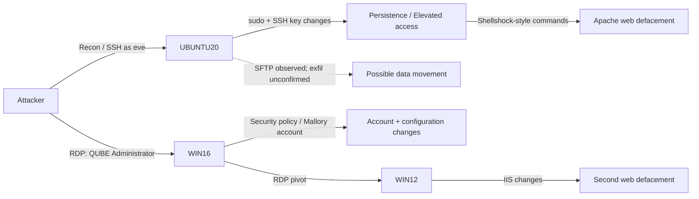

# Case Study 01 — Web Defacement, SSH Persistence & Windows Lateral Movement

**Incident date:** April 12, 2026 (UTC)  
**Type:** Web defacement and unauthorized access  
**Setting:** Simulated attack against a university course lab  
**Evidence sources:** Suricata, Wazuh, Velociraptor, network and endpoint logs

[← Back to portfolio](README.md) · [Evidence gallery](evidence/EVIDENCE_INDEX.md) · [Timeline CSV](timelines/web_defacement_2026-04-12.csv)

## Executive summary

On April 12, 2026, the team investigated an attack that compromised Linux and Windows lab systems. Suspicious scanning was followed by an SSH login to **UBUNTU20** using the existing **eve** account. The attacker elevated privileges, adjusted the SSH service and authorized keys to establish persistence, and used Shellshock-style Bash commands to change the Apache website. SFTP activity raised a concern about data leaving the machine, but the available findings do **not** confirm which files, if any, were transferred out.

In the Windows environment, the attacker used the **QUBE\\Administrator** account over RDP to access **WIN16**. The investigation documented changes to security policies, the creation of a **Mallory** account with Print Operators membership, and an RDP connection to **WIN12**, where the IIS website was modified. The report assessed the incident as high/critical severity because multiple hosts and public-facing web services were affected.

**Primary finding:** Misuse of valid credentials and excessive privileges enabled multi-host compromise and changes to two web applications. The team's root-cause assessment pointed to weak credential lifecycle/access controls; it did not prove exactly how the passwords were originally obtained.

## What was affected

| Host | Role | Observed or documented impact |
|---|---|---|
| **UBUNTU20** | Linux host running Apache | SSH access, sudo/root activity, persistence-related SSH changes, Apache web content modification, suspicious SFTP |
| **WIN16** | Windows server/domain-connected host | RDP using administrative credentials, security policy activity, new Mallory account and Print Operators membership |
| **WIN12** | Windows host running IIS | RDP from Windows environment and IIS web content/service changes |
| **ALMA09** | Honeypot | Probed during initial network scanning; not confirmed compromised in the report |

## Attack path

*The diagram summarizes the sequence presented in the team evidence. It does not claim that UBUNTU20 served as the RDP pivot to WIN16.*

## Reconstructed investigation timeline

| UTC time | Phase | Observation / documented action | Interpretation |
|---|---|---|---|
| 07:45:27 | Reconnaissance | Network scanning, including honeypot activity | Scope of initial network probing |
| 07:48:57 | Initial access | SSH session opened on UBUNTU20 as eve | Valid-account access |
| 07:49:13 | Privilege escalation | sudo / `su -` usage | Elevated privileges on Linux |
| 07:49:18–07:49:24 | Persistence | SSH daemon settings and authorized-key file changed | Access persistence indicators |
| 07:49:54–07:50:03 | Impact | Shellshock-style commands changed web content and restarted Apache | Linux website defacement |
| 07:50:08 | Discovery | `nmap -sV` activity targeting WIN12 | Service/version probing |
| 07:50:42 | Collection / exfil concern | SFTP process activity | Suspicious; confirmed transfer not established |
| 07:53:55 | Windows access | RDP session to WIN16 as QUBE\\Administrator | Windows administrative access |
| 07:54–07:55 | Persistence / privilege changes | Security policy modifications; Mallory account and group changes | Account and policy manipulation |
| 07:56:23 | Lateral movement | RDP pivot from WIN16 to WIN12 | Reach into second Windows host |
| ~07:58–07:59 | Impact | IIS-related process and web-content activity | Windows website defacement |

*Times are reconstructed from Lab 7 checkoff slides, pp. 3–8. The table rounds or groups selected timestamps for readability; see CSV for the more precise entries.*

## Key evidence

### 1. Network reconnaissance

**Finding:** Suricata/network events were used to identify initial scanning and guide subsequent host investigation.

### 2. SSH initial access

**Finding:** Logs show successful SSH authentication and a session for the account **eve** on UBUNTU20.

### 3. SSH service and key persistence

**Finding:** Execution records show SSH configuration modification, service restart, and changes involving **authorized_keys**. These support the team's persistence assessment.

### 4. Apache website modification

**Finding:** Process execution evidence includes Shellshock-style environment-variable commands writing to Apache web files and restarting the web service.

### 5. SFTP: possible exfiltration, not a confirmed data-loss event

**Finding:** SFTP-related execution was detected. The supplied material does **not** identify a validated destination file list, transferred contents, or confirmed bytes exfiltrated.

### 6. Windows administrative RDP activity

**Finding:** Authentication artifacts support RDP access to WIN16 using administrative credentials.

### 7. RDP movement into WIN12

**Finding:** Windows logon/logoff events align with the reported pivot to WIN12.

### 8. IIS web service manipulation

**Finding:** IIS-related process activity and the investigation narrative support changes to the Windows web server.

## MITRE ATT&CK mapping

The playbook attributed the following techniques to the investigation; mapping is included as **team analysis**, not an assertion that every technique was independently revalidated.

| Phase | Technique | ID |
|---|---|---|
| Reconnaissance | Active Scanning: Scanning IP Blocks | T1595.001 |
| Initial Access | Valid Accounts: Local Accounts | T1078.003 |
| Initial Access | Valid Accounts: Domain Accounts | T1078.002 |
| Execution | Command and Scripting Interpreter: Unix Shell | T1059.004 |
| Persistence | Account Manipulation: SSH Authorized Keys | T1098.004 |
| Discovery | Network Service Discovery | T1046 |
| Lateral Movement | Remote Services: Remote Desktop Protocol | T1021.001 |
| Impact | Defacement: External Defacement | T1491.002 |
| Possible Exfiltration | Exfiltration Over Alternative Protocol (team playbook classification, not proven) | T1048.002 |

## CIA triad impact

- **Confidentiality:** Unauthorized account and system access; potential data exposure. Data exfiltration was **suspected but not established**.
- **Integrity:** Apache and IIS websites were modified, with account/security configuration changes.
- **Availability:** Legitimate website content was replaced or disrupted, even though the web services could still respond.

## Containment and recovery recommendations

The playbook recommends restricting access to impacted machines while preserving logs, maintaining visibility for new attacker activity, removing unauthorized keys/accounts/scripts, and restoring compromised hosts from known-good backups. It proposes an **RTO of 6–10 hours**, which is a planned target, **not a measured recovery duration**.

**High-priority improvements:** Enforce MFA on SSH and RDP where supported, rotate potentially exposed credentials, restrict administrative privileges, review SSH keys and server configurations, prevent unnecessary east-west RDP/SMB/SSH access, improve Nmap/SSH/RDP detection, and patch exposed systems.

## Limits and reliability

- The team hypothesized insider or former-insider knowledge due to apparent valid-credential use; **attacker identity was not confirmed**.
- The material documents attacker behavior and **response plans**; it does not provide conclusive before-and-after validation for all proposed recovery actions.
- The checkoff slide timeline provides minute/second-level reconstruction. Source log screenshots should be consulted for event-level precision.
- This was a team-based, simulated incident in a course environment.

**Original supporting files supplied for this case:** `CNIT 470 Lab 7 - Checkoff Slides.pptx` (evidence/timeline), `Updated Lab 7 IR playbook.docx` (analysis/response recommendations).
