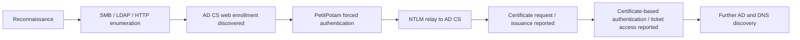

# Case Study 02 — Active Directory Certificate Services & NTLM Relay Investigation

**Incident date:** April 30, 2026 (UTC)  
**Type:** Authentication abuse, AD CS exposure, NTLM relay (reconstructed attack)  
**Setting:** Simulated university course lab  
**Evidence sources:** Suricata, Wazuh, Velociraptor, Windows authentication and process events

[← Back to portfolio](README.md) · [Evidence gallery](evidence/EVIDENCE_INDEX.md) · [Timeline CSV](timelines/adcs_ntlm_2026-04-30.csv)

## Executive summary

On April 30, 2026, a team investigation focused on a suspected compromise of an Active Directory environment through **NTLM authentication relay and Active Directory Certificate Services (AD CS)**. The case report describes network enumeration of SMB (445), LDAP (389), and HTTP (80), followed by suspicious authentication traffic, enumeration of directory information, and exposure of a certificate web-enrollment service.

The investigation narrative reconstructs an attack in which **PetitPotam** coerced authentication, **ntlmrelayx** relayed NTLM authentication to AD CS, and the attacker obtained a certificate that could be used for machine authentication and additional access. The report then describes Kerberos ticket/NTLM material retrieval and additional domain discovery. The supplied appendix screenshots independently illustrate **HTTP/network alerts, NTLM authentication fields, privileged logon events, and PowerShell/process activity**; they do not independently prove every link in the certificate-abuse narrative.

**Main finding:** An inadequately hardened identity and certificate-enrollment environment can allow a network authentication issue to become a wider domain-security risk. The team's investigation recommends AD CS hardening, stronger authentication controls, NTLM reduction, and better monitoring.

## Investigation scope

| Area | Role in report | Main risk |
|---|---|---|
| **Domain Controller / AD** | Authentication, LDAP directory information, domain accounts | Compromise of credentials and elevated access |
| **AD CS web enrollment** | Certificate issuance / HTTP service | Certificate abuse and unauthorized authentication |
| **Windows Server 2012 / WIN12-27** | Network and authentication telemetry for internal server | NTLM and related logon activity |
| **SMB, LDAP, HTTP** | Network protocols seen or enumerated during investigation | Relaying authentication, reconnaissance, exposed services |

## Reconstructed attack chain

*Dashed evidentiary boundary in prose: network/authentication telemetry is visible in the appendices, while the full certificate request and ticket chain is documented in the team's written reconstruction.*

## Timeline reconstructed by the team

| UTC time | Event | Source named in original timeline | Evidence note |
|---|---|---|---|
| 17:10:14 | Malformed HTTP requests to a web server; initial probing | Suricata | Documented in final report timeline |
| 17:10:14–15 | NTLM authentication traffic over SMB between internal host and outside address | Suricata | NTLM fields shown in Wazuh screenshot; specific packet timing from report |
| 17:10:18 | LDAP domain and structural queries | Velociraptor | Reported in timeline |
| 17:10:19 | HTTP 401 response associated with AD CS enrollment discovery | Suricata | Reported interpretation of HTTP response |
| 17:10:20–21 | Attacker-side NTLM relay listener preparation | Suricata | Reconstructed by team; not independently visible in exported screenshot |
| 17:10:30 | Coerced endpoint authentication | Velociraptor | Reported by team |
| 17:10:40 | Certificate obtained through authentication interaction | Velociraptor / Wazuh | Reported; certificate artifact not provided separately |
| 17:10:46 | DNS record discovery | Velociraptor / Wazuh | Reported by team |
| 17:10:50–17:30 | Follow-on logons, scripts and service events | Wazuh | Relevant screenshots provided |

## Selected supporting evidence

### 1. Suricata HTTP/network security alerts

**Finding:** Repeated HTTP-focused IDS alerts support the early suspicious-traffic portion of the team's investigation. The screenshot alone does **not** validate AD CS certificate issuance.

### 2. NTLM authentication telemetry

**Finding:** Wazuh records show **NTLM V2** authentication fields, relevant account metadata, and network addresses. These were treated as possible indicators of credential abuse.

### 3. Privileged logon activity

**Finding:** Windows security-event details document privileged logon activity in the investigation window.

### 4. PowerShell execution artifacts

**Finding:** Process records show PowerShell launched during the period of suspicious activity. Command purpose is not independently established from this screenshot.

### 5. Final event timeline view

**Finding:** Security-event timelines help correlate endpoint findings across hosts near the end of the incident.

## MITRE ATT&CK mapping from team playbook

| Activity | Mapping | ID |
|---|---|---|
| Port and service enumeration | Network Service Discovery | T1046 |
| Account queries | Account Discovery: Domain Account | T1087.002 |
| Valid account use | Valid Accounts: Domain Accounts | T1078.002 |
| Reported certificate abuse | Steal or Forge Authentication Certificates | T1649 |
| Reported SMB/Windows movement | Remote Services: SMB/Windows Admin Shares | T1021.002 |

*These are classifications appearing in the report, not a fresh independent validation. The source playbook has spelling inconsistencies in the ATT&CK labels; names above are normalized for readability.*

## Security impact

- **Confidentiality:** The team's report assessed credential/authentication exposure and unauthorized access.
- **Integrity:** Risks included the ability to abuse certificate-based authentication and manipulate identity-related controls.
- **Availability:** The summary concluded that availability was **not materially affected by the main attack objective**, although the detailed event timeline mentions some later service outages. The record does not establish the scope or cause of those outages.

## Recommendations ranked by importance

| Priority | Action | Why it matters |
|---|---|---|
| High | Restrict or disable unnecessary AD CS web enrollment | Reduces exposed certificate request paths |
| High | Enforce SMB signing where appropriate | Reduces the opportunity for certain NTLM relays |
| High | Reduce or disable NTLM where feasible and tested | Limits dependence on relay-prone authentication flows |
| High | Harden certificate templates, permissions, and issuance controls | Prevents inappropriate certificate enrollment |
| High | Monitor certificate requests and authentication coercion patterns | Improves detection of identity abuse |
| High | Restrict privileged accounts and review access | Limits credential impact and lateral movement |
| Medium | Improve LDAP query monitoring and detection | Improves visibility into domain enumeration |

## Containment/recovery status and limitations

The source playbook **states** that unauthorized scripts/certificates were removed, affected systems were restored from pre-attack backups, and full functionality returned within 24 hours. Because no separate validation artifacts for these recovery claims were included in the uploaded materials, they are presented as **reported outcomes**, not independently confirmed results.

The original written report combines observed telemetry with a reconstructed attack chain. This distinction matters: suspicious NTLM traffic by itself is not definitive proof of a successful NTLM relay or a maliciously issued certificate. No confirmed data exfiltration or destructive impact was documented for this incident.

**Original supporting file supplied for this case:** `Final incident Response.docx` (NTLM/AD CS playbook, timeline, lessons learned and screenshots).
